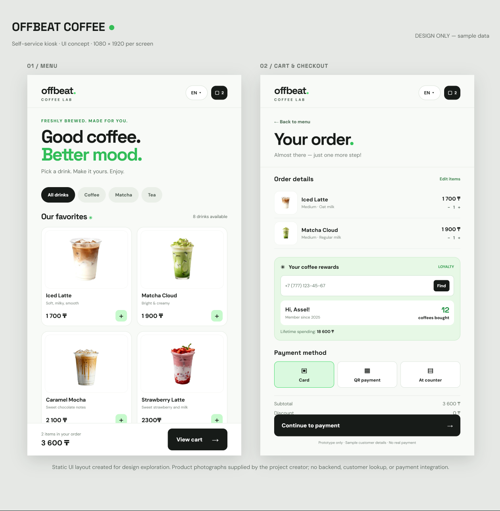

**Assel Aldabergen**

**Computer Science student at Astana IT University** &nbsp;·&nbsp; **UI/UX design enthusiast**  
Astana, Kazakhstan &nbsp;·&nbsp; Expected graduation: 2027

[Portfolio projects](#selected-work) &nbsp;·&nbsp; [Technical projects](#development--machine-learning) &nbsp;·&nbsp; [Email](mailto:aselaldabergenova03@gmail.com)

---

### About

I'm a third-year Computer Science student exploring **UI/UX design** and the intersection of visual design and technology. I enjoy shaping clear, easy-to-use interfaces and bring a technical perspective from web development, machine learning, and research projects.

### Selected work

#### 01 / OFFBEAT Coffee — Self-Service Kiosk

**UI/UX concept · Figma · HTML · CSS**  
[View repository](https://github.com/aaldabergenn/offbeat-coffee-kiosk)

A two-screen ordering-kiosk concept for a coffee shop. Designed the product menu, cart, loyalty-card lookup interface, customer purchase summary, and payment-method selection. This is a **visual prototype**, not a live payment or database system.

### Development & Machine Learning

#### 02 / Teaching AI to Play Pong — Double DQN vs. PPO

**Reinforcement learning · Python · PyTorch · Gymnasium**  
[View repository](https://github.com/aaldabergenn/pong-rl-dqn-vs-ppo)

A collaborative university project implementing a custom Pong environment and comparing Double DQN with PPO. Includes training experiments and head-to-head gameplay evaluation.

Recorded gameplay from the course project; developed with Bakhtiyar Abussagitov.

#### 03 / Network Intrusion Detection & Anomaly Analysis

**Machine learning · Python · Scikit-learn · KDD Cup 1999**  
[View repository](https://github.com/aaldabergenn/network-intrusion-detection-ml)

Explored network-traffic preprocessing, rule-derived attack-severity estimation, clustering, and anomaly detection as part of an academic cybersecurity ML project.

#### 04 / Star Wars Species Classifier

**Machine learning · Python · Scikit-learn**  
[View repository](https://github.com/aaldabergenn/star-wars-species-classifier)

Explored Human versus Non-Human classification using character features, Decision Tree, KNN, Random Forest, Gradient Boosting, and K-Means clustering.

#### 05 / Coffee Shop Website

**Web development · HTML · CSS · JavaScript · Express · MongoDB**  
*University project — source recovery in progress*

Built a coffee-ordering web application featuring accounts, a product menu, custom drink options, a cart, and order submission. The original frontend has been partially recovered; the full working application is not currently published.

### Research

#### 06 / Machine Learning for Individualized Warfarin Dosing

**Healthcare ML · Research project**  
*Unpublished manuscript — being revised for potential journal submission*

Investigated how missing-data handling and cross-site validation affect machine-learning approaches to individualized warfarin dose prediction using the IWPC cohort. Code, findings, and manuscript are not publicly shared at this stage.

---

### Tools & skills

**Design:** Figma Make 
**Development:** Python, HTML, CSS, JavaScript, SQL; basic Java  
**Other tools:** VS Code, PyCharm

### Languages

Kazakh — native &nbsp;·&nbsp; Russian — fluent &nbsp;·&nbsp; English — B2 &nbsp;·&nbsp; Korean — upper-intermediate

### Contact

[E-mail](mailto:aselaldabergenova03@gmail.com) &nbsp;·&nbsp; [GitHub](https://github.com/aaldabergenn)
