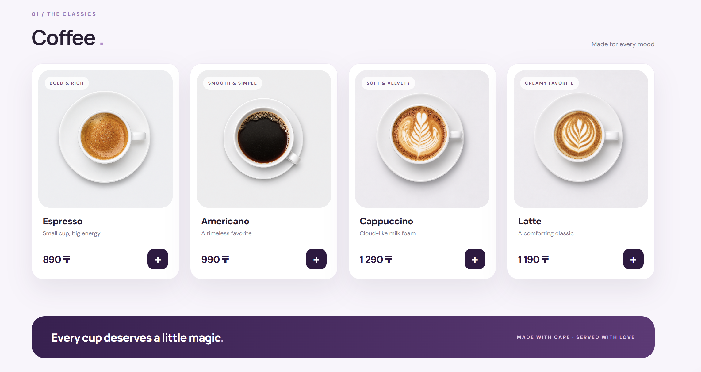
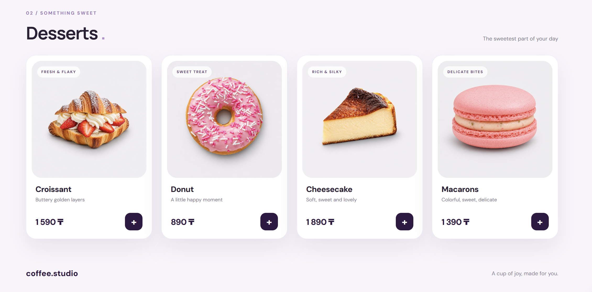
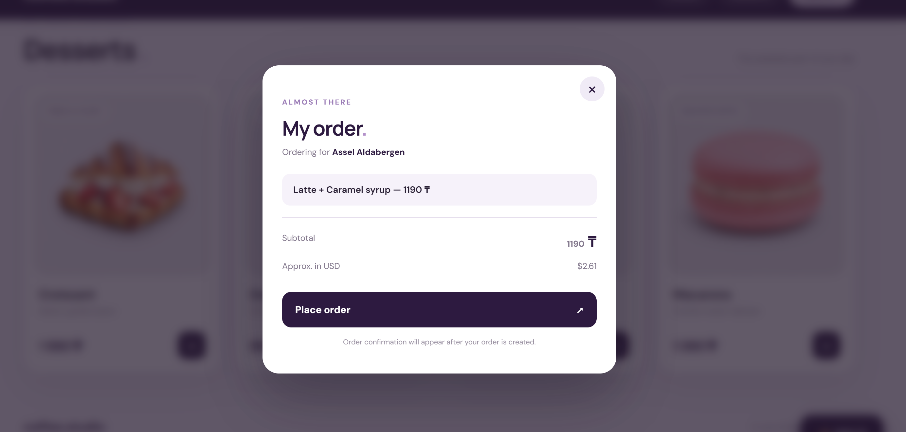
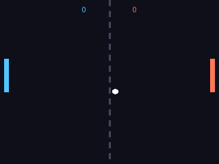

# Assel Aldabergen

**Computer Science student at Astana IT University · Aspiring UI/UX Designer**  
Astana, Kazakhstan · Expected graduation: 2027

[Design & web projects](#selected-work) · [Technical projects](#development--machine-learning) · [Contact](#contact)

---

## About

I'm a third-year Computer Science student with an interest in UI/UX design, web development, and machine learning. I enjoy creating clear, practical interfaces and bringing together visual design and technical implementation.

## Selected work

### 01 / OFFBEAT Coffee — Self-Service Kiosk

**UI/UX concept · Figma Make · HTML · CSS**  
[View repository](https://github.com/aaldabergenn/offbeat-coffee-kiosk)

A two-screen coffee ordering kiosk concept covering the menu, cart, loyalty-card lookup, customer purchase summary, and payment-method selection. This is a UI prototype, not a connected payment or customer database system.

### 02 / Coffee Studio — Full-Stack Coffee Ordering Website

**UI design & web development · HTML · CSS · JavaScript · Node.js · Express · MongoDB**  
[View repository](https://github.com/aaldabergenn/coffee-studio-fullstack)

A functional coffee ordering website with a lavender-and-deep-purple interface. Features include user registration and login, a menu of coffee and desserts, syrup customization, a shopping cart, order creation, and approximate KZT-to-USD conversion through an exchange-rate API.

**Coffee menu**

**Desserts menu**

**Shopping cart and currency conversion**

### 03 / dorama. - Drama Streaming Platform

**UI/UX Design · Figma · 2026**

**Status: Work in Progress — Early Design Stage**

An ongoing UI/UX design project for a drama streaming platform focused on intuitive navigation, drama discovery, and a seamless viewing experience.

Currently designing the interface in Figma, starting with the homepage, drama cards, navigation, and continue-watching experience.

**Current progress:**
- Initial wireframes and page structure
- Visual identity and color palette
- Homepage UI design
- Drama cards with ratings
- Continue-watching section with episode progress

**Next steps:** Drama details, catalog, advanced filters, video player, and interactive prototype.

[View Project](https://github.com/aaldabergenn/dorama-uiux-design)

## Development & Machine Learning

### 04 / Teaching AI to Play Pong — Double DQN vs. PPO

**Reinforcement learning · Python · PyTorch · Gymnasium**  
[View repository](https://github.com/aaldabergenn/pong-rl-dqn-vs-ppo)

A collaborative university project that implements a custom Pong environment and compares Double DQN and PPO using training experiments and gameplay evaluation.

Course project with Bakhtiyar Abussagitov.

### 05 / Network Intrusion Detection & Anomaly Analysis

**Machine learning · Python · Scikit-learn · KDD Cup 1999**  
[View repository](https://github.com/aaldabergenn/network-intrusion-detection-ml)

Academic work on traffic preprocessing, attack-severity estimation, clustering, and anomaly analysis.

### 06 / Star Wars Species Classifier

**Machine learning · Python · Scikit-learn**  
[View repository](https://github.com/aaldabergenn/star-wars-species-classifier)

Classification of fictional characters using Decision Tree, KNN, Random Forest, Gradient Boosting, and clustering techniques.

## Research

### 07 / Machine Learning for Individualized Warfarin Dosing

**Healthcare ML · Research project**  
*Unpublished manuscript — in revision for potential journal submission*

Research exploring missing-data handling and cross-site validation for machine-learning-based warfarin dose prediction. The manuscript and research code are not publicly shared.

---

## Tools & skills

**Design:** Figma 
**Programming:** Python, HTML, CSS, JavaScript, SQL; basic Java  
**Tools:** VS Code, PyCharm

## Languages

Kazakh — native · Russian — fluent · English — B2 · Korean — upper-intermediate 

## Contact

[Email](mailto:aselaldabergenova03@gmail.com) · [GitHub](https://github.com/aaldabergenn)
